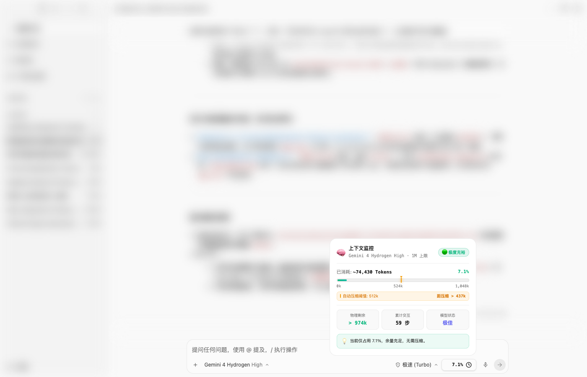
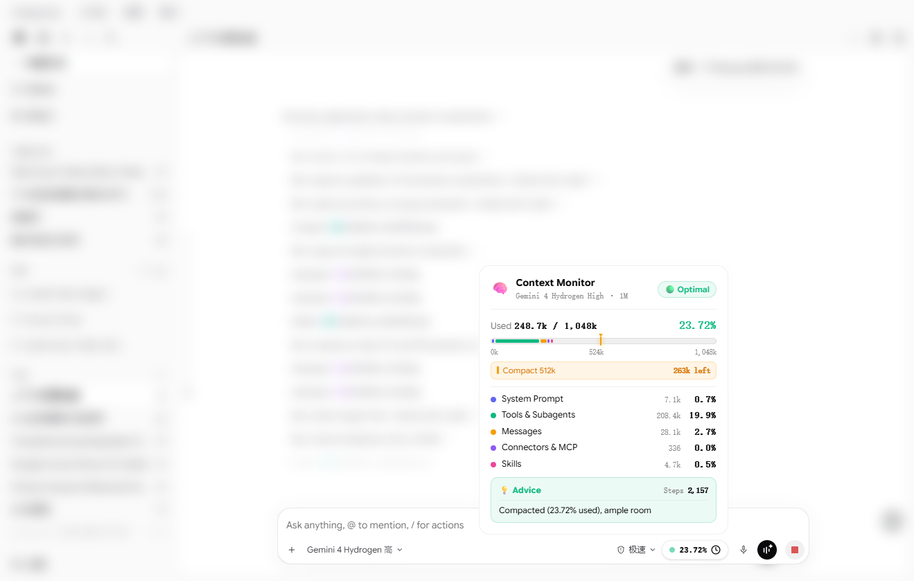

# 🧠 Antigravity Context Monitor
### Google Antigravity 上下文监控插件

<p align="center">
  
  
  
  
  
  
</p>

[English](#english) | [中文说明](#chinese)

---

<p align="center">
  
  
</p>

---

<a name="english"></a>
## English

A lightweight, real-time context window and token usage monitor custom-built for **Google Antigravity 2.0 Desktop**. Seamlessly embeds right into the bottom input toolbar next to the microphone button, expanding into a floating dashboard card on hover.

### 🌟 Key Features

- **⚡ Native Input Bar Integration**: Injects seamlessly into the bottom input toolbar without modifying any Antigravity application binaries.
- **🎨 350px Floating Dashboard (Hover to Expand)**:
  - **Dynamic Model & Limit Detection**: Reads active model in real-time (e.g., `Gemini 4 Hydrogen High · 1M Max`, `Claude Opus 5.5 · 1M Max`, `GPT-OSS 120B · 128k Max`) and adapts the progress bar scale automatically.
  - **Auto-Compact Threshold Marker**: Displays an amber marker on the progress bar showing Antigravity's actual Checkpointer auto-compaction trigger (`512k` / `256k` / `128k` / `80k`) and live remaining headroom before compaction.
  - **Color-Coded Status Pulse**: 🟢 Optimal ｜ 🟡 Near Auto-Compact ｜ 🔴 Compact Soon.
  - **3 Metric Blocks**: Physical remaining space, interaction steps, and model status.
  - **Context Advice**: Timely guidance for summarizing or running `/compact`, plus in-chat Markdown cards via `generate_monitor.py` with `│` threshold markers.

#### Supported Model Limits & Auto-Compact Thresholds

| Model Family | Physical Window | Auto-Compact Threshold |
| :--- | :--- | :--- |
| **Gemini 4 Hydrogen / Argon / Carbon** | `1,048k` (`1M`) | **`512k`** |
| **Gemini 3.8 Flash** | `1,048k` (`1M`) | **`256k`** |
| **Claude Opus 5.5 / Sonnet 5.5** | `1,000k` (`1M`) | **`256k`** |
| **Gemini 3 Flash / 2.5 Pro / 3.5 Lite** | `1,048k` (`1M`) | **`128k`** |
| **GPT-OSS 120B (Medium)** | `131k` (`128k`) | **`80k`** |
- **🌐 Automatic Bilingual Selection**:
  - Automatically identifies system language. If Chinese (`zh`) -> Chinese UI; if non-Chinese -> English UI.
  - Engineered with strict layout constraints to prevent English text overflow, line breaks, or font misalignment.
- **🛡️ Cross-Platform Auto-Reconnection & Zero-Crash Resilience**:
  - **Dynamic Port Hot-Discovery**: Automatically locates `DevToolsActivePort` across macOS (`~/Library/Application Support/Antigravity/`), Windows (`%APPDATA%\Antigravity\`), and Linux (`~/.config/Antigravity/`) to re-hook within 2s after client restarts.
  - **DOM Self-Healing**: Uses `MutationObserver` to re-mount the gauge automatically whenever the input container re-renders or navigates.
  - **System Persistence**: Integrates with Antigravity Sidecars, macOS `LaunchAgent`, and Windows Startup Registry/Folder for silent background startup on reboot.

---

### 🚀 Quick Start (1-Click Install)

#### Requirements
- **Google Antigravity 2.0 Desktop** (Windows or macOS)
- **Python 3.9+**

#### Installation
1. Clone or download this repository:
   ```bash
   git clone https://github.com/wwwljxw/antigravity-context-monitor.git
   ```
2. Run **`python3 install.py`** (or double-click **`install.bat`** on Windows).
3. Launch or restart **Antigravity 2.0** (on macOS, the gauge also mounts live immediately!).
4. The context gauge will appear in your bottom input toolbar!

#### Uninstallation
- Run **`python3 uninstall.py`** (or double-click **`uninstall.bat`** on Windows) to cleanly terminate the background daemon and remove all configuration entries.

---

<a name="chinese"></a>
## 中文说明

为 **Google Antigravity 2.0 桌面客户端** 定制的轻量级实时上下文监控插件。通过本地调试管道与 DOM 监听机制，无侵入式地内嵌至输入框右下角。

### 🌟 核心功能

- **⚡ 输入框原生嵌入**：无缝融入 Antigravity 2.0 底部工具栏（麦克风图标正前方），丝滑契合原生暗色与明色主题。
- **🎨 350px 悬浮大卡片（鼠标悬停即弹）**：
  - **动态模型与真实上限感知**：实时捕获当前选用的模型（如 `Gemini 4 Hydrogen High · 1M 上限`、`Claude Opus 5.5 · 1M 上限`、`GPT-OSS 120B · 128k 上限`），自动切换刻度尺与上限。
  - **自动压缩阈值标线**：在进度条上直观标出 Antigravity 实际的 Checkpointer 自动压缩触发线（如 `512k` / `256k` / `128k` / `80k`），并实时提示“距触发压缩还剩多少空间”。
  - **三色呼吸警示灯**：🟢 极度充裕 ｜ 🟡 接近压缩线 ｜ 🔴 即将压缩。
  - **三核心指标网格**：物理剩余空间、累计交互步数、模型状态。
  - **阶段健康建议**：精准的阶段性总结与 `/compact` 压缩提示，同时支持通过对话 Skill 输出带 `│` 压缩标线的 Markdown 进度条卡片。

#### 支持模型窗口与自动压缩阈值对照

| 模型系列 | 物理窗口 (`maxTokens`) | 自动压缩阈值 (`max_token_limit`) |
| :--- | :--- | :--- |
| **Gemini 4 Hydrogen / Argon / Carbon** | `1,048k` (`1M`) | **`512k`** |
| **Gemini 3.8 Flash** | `1,048k` (`1M`) | **`256k`** |
| **Claude Opus 5.5 / Sonnet 5.5** | `1,000k` (`1M`) | **`256k`** |
| **Gemini 3 Flash / 2.5 Pro / 3.5 Lite** | `1,048k` (`1M`) | **`128k`** |
| **GPT-OSS 120B (Medium)** | `131k` (`128k`) | **`80k`** |
- **🌐 中英双语自动切换（非中文 ➡️ 英文）**：
  - 自动读取系统语言：中文环境直接显示中文，非中文环境（英文等）自动呈现为地道的英文排版。
  - 针对英文字符较长特点进行了专门的防溢出重构，绝不发生折行、错位或内容截断。
- **🛡️ 跨平台动态端口热重连与常驻守护**：
  - **动态端口热感知**：自动探测 macOS (`~/Library/Application Support/Antigravity/`)、Windows (`%APPDATA%\Antigravity\`) 与 Linux (`~/.config/Antigravity/`) 下的 `DevToolsActivePort`，客户端重启后 2 秒内无缝热重连。
  - **DOM 自动挂载**：内置 `MutationObserver`，切换会话、页面刷新或版本升级时自动重建自愈。
  - **系统级守护**：同时支持 Antigravity Sidecar、macOS `LaunchAgent`、Windows 注册表 `Run` 自启与启动文件夹，开机完全静默运行，内存消耗约 20MB，CPU 占用近乎 0%。

---

### 🚀 一键安装与使用

#### 前置环境
- 已安装 **Antigravity 2.0 桌面版**（支持 Windows / macOS）
- 已安装 **Python 3.9+**

#### 安装步骤
1. 下载或克隆本项目：
   ```bash
   git clone https://github.com/wwwljxw/antigravity-context-monitor.git
   ```
2. 运行 **`python3 install.py`**（Windows 可直接双击 **`install.bat`**）。
3. 打开或重启 **Antigravity 2.0**（macOS 安装后当前会话即可实时生效）。
4. 输入框右下角即可看到呼吸跳动的小胶囊，鼠标悬停即可浮出仪表盘！

#### 卸载步骤
- 运行 **`python3 uninstall.py`**（Windows 可双击 **`uninstall.bat`**）即可一键彻底停止进程并清理所有文件和自启项。

---

### 📂 项目结构

```text
antigravity-context-monitor/
├── assets/                  # 演示截图
│   ├── preview_zh.png       # 中文界面效果图
│   └── preview_en.png       # 英文界面效果图
├── skills/
│   └── context-monitor/
│       ├── SKILL.md         # Antigravity 技能元数据
│       └── scripts/
│           ├── daemon_sync.py       # 后台热探测、动态计算与 DOM 驱动引擎
│           ├── generate_monitor.py  # 会话容量分析与 Markdown 卡片生成器
│           └── inject_gauge.py      # CDP 前端组件注入脚本
├── plugin.json              # 插件配置文件
├── install.py / install.bat # 双语自适应一键安装器
├── uninstall.py / uninstall.bat # 双语一键卸载器
├── LICENSE                  # MIT 开源协议
└── README.md                # 中英双语项目说明
```

---

### 📄 License

本项目基于 [MIT License](LICENSE) 开源。欢迎 Star 与 Fork！
